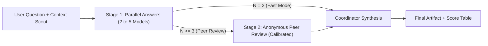
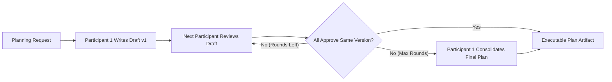

# agy-council

`agy-council` is a multi-model skill for [Google Antigravity](https://antigravity.google).
It lets two or more AI models answer hard questions together or agree on one technical plan.

The skill runs inside Antigravity. You do not need external servers, Docker containers, or API keys.

---

## Credit and Enhancements

### Inspiration
Andrej Karpathy's [`karpathy/llm-council`](https://github.com/karpathy/llm-council) inspired the multi-model council workflow in **Mode 1**. In Karpathy's design, several models answer the same prompt, review anonymous peer answers, and let a chairman model write the final response.

### What `agy-council` Adds
`agy-council` adapts that concept into a native Antigravity skill and adds seven capabilities:

1. **Blind Consensus Plan Mode (Mode 2)**: Two or three models take turns revising one shared Markdown plan. No model knows that other models exist.
2. **Strict Unanimous Exit**: Consensus Mode stops early only when every model approves the exact same plan version with zero edits. If the models reach the round limit without agreement, `Participant 1` writes a final consolidated plan.
3. **Zero-Reemission Plan Approvals**: On approval turns, models write only a tiny metadata file (`turn_N.meta.json`) and skip re-writing the full Markdown plan. This prevents JSON-escaping errors and saves output tokens.
4. **Fast 2-Seat Council & Calibrated 3+ Seat Scoring**: Two-seat runs default to **Fast Council** (parallel answers + direct Coordinator synthesis) to avoid uncalibrated 2-way scoring. Three-or-more-seat runs use self-excluded two-axis grading (**Accuracy 1–10** + **Insight 1–10**) with reviewer mean-centering.
5. **Coordinator Synthesis**: The Coordinator reads the isolated answers and reviews directly instead of waking a biased Stage 1 worker as Chairman.
6. **Barrier Pings & Context Scout**: Workers use an atomic `mark-done` barrier so the Coordinator wakes once per parallel stage. A single pre-flight Context Scout pass avoids redundant repo reads across seats.
7. **Executable Plan Artifacts**: Consensus Mode outputs an Antigravity Plan Artifact with a **Proceed** button so you can run the agreed plan immediately.

---

## Functional Overview

*(Written in ASD-STE100 Simplified Technical English)*

### Mode 1: Council Q&A (`council`)

Use Council Mode for open architectural trade-offs, security audits, or breaking single-model tunnel vision.



1. **Pre-Flight Context Scout**: The Coordinator reads needed workspace files once into `context.txt`.
2. **Stage 1 — Independent Answers**: From 2 to 5 models answer in parallel and write separate files. The last finishing worker sends one barrier ping (`@coordinator stage1 all done`).
3. **Stage 2 — Anonymous Peer Review (`N >= 3` or `--peer-review`)**: The helper removes model names and shuffles the answer order. Each model grades only the other models on **Accuracy (1–10)** and **Insight (1–10)**.
4. **Stage 3 — Coordinator Synthesis**: The helper builds an anonymized bundle (`stage3_bundle.md`) with calibrated scores. The Coordinator writes one complete final answer, and Antigravity publishes the Markdown Artifact.

### Mode 2: Blind Consensus Plan (`consensus`)

Use Consensus Mode when you want two or three models to challenge and improve a high-risk implementation plan until they agree.



1. **Random Slot Assignment**: The helper assigns 2 or 3 models at random to `Participant 1`, `Participant 2`, and (optional) `Participant 3`.
2. **Blind One-on-One Framing**: Each model works inside its own conversation and does not know about other models.
3. **Turn-by-Turn Revision**: On each turn, the active participant reads the latest draft. It either writes `agreed: true` in `turn_N.meta.json` without rewriting the plan, or writes an updated `turn_N.plan.md` (which resets prior approvals).
4. **Completion or Consolidation**: The loop stops as soon as all participants approve the same version (up to 2 rounds per model by default). If rounds run out first, `Participant 1` resolves open items into one final plan.
5. **Output**: Antigravity writes a Plan Artifact with a **Proceed** button, turn-by-turn diffs, and a hidden spoiler section that reveals which model played each participant.

---

## Default Models and Portability

`agy-council` includes two built-in engines so it works across different Antigravity accounts and settings:

| Engine | When Used | Default Seats |
| :--- | :--- | :--- |
| **Cross-Vendor `swarm`** *(Primary)* | Whenever the `swarm` tool is active (Gemini coordinator selected) | **Gemini 4 Carbon** (`gemini-4-carbon-high`) + **Claude Opus 4.6** (`claude-opus-4-6-thinking`) |
| **Tier-Based `run_workflow`** *(Fallback)* | When `swarm` is unavailable in the current session | `inherit` (your selected chat model) + `pro` |

At the start of each `swarm` run, the skill checks live model availability and quota on your account. You can also add models such as `gpt-oss-120b-medium`, `gemini-4-hydrogen-xhigh`, or `claude-sonnet-4-6`. If a default model has `0%` quota, the skill selects an available model automatically.

---

## Requirements

- [Google Antigravity](https://antigravity.google)
- Python 3.8 or newer on `PATH` (uses only the Python standard library)

---

## Installation

### Option A: Install Globally (All Projects)

1. Create your global skills folder if it does not exist:
   ```bash
   mkdir -p ~/.gemini/config/skills
   ```
2. Clone this repository as `council`:
   ```bash
   git clone https://github.com/kdvlr/agy-council.git ~/.gemini/config/skills/council
   ```
3. Start a new Antigravity conversation.

### Option B: Install in One Workspace Only

1. Run this command from the root of your project repository:
   ```bash
   git clone https://github.com/kdvlr/agy-council.git .agents/skills/council
   ```
2. Start a new Antigravity conversation in that project.

### Update to the Latest Version

```bash
git -C ~/.gemini/config/skills/council pull
```

---

## Usage Examples

Ask Antigravity in plain language:

- **Fast Council Mode (2-Seat Q&A)**:
  > *"Run a council on whether this service should use SQLite WAL or PostgreSQL."*
- **Consensus Mode (Planning)**:
  > *"Use council consensus mode to write a migration plan from JWT cookies to passkeys."*
- **3-Seat Peer-Reviewed Audit**:
  > *"Run a 3-model council with Gemini 4 Carbon, Claude Opus 4.6, and GPT-OSS 120B to audit `src/auth/`."*

---

## Worker Turn Cost

Every worker turn uses your Antigravity model quota:

- **Fast Council (2 seats)**: 2 parallel worker turns + Coordinator synthesis.
- **Peer-Reviewed Council ($N \ge 3$ seats)**: $2N$ worker turns ($N$ answers + $N$ reviews) + Coordinator synthesis.
- **Consensus Mode ($K$ seats, $R=2$ default max rounds)**: From $K$ turns (immediate agreement) up to $K \times R + 1$ worker turns.

---

## Repository Layout

```text
agy-council/
├── SKILL.md                     # Antigravity skill manifest and instructions
├── README.md                    # Documentation (Simplified Technical English)
├── LICENSE                      # MIT License
├── scripts/
│   ├── swarm_helper.py          # Primary cross-vendor swarm state and barrier helper
│   └── council_workflow.py      # Fallback run_workflow engine
└── tests/
    └── test_swarm_helper.py     # Standard-library unit tests
```

Run the test suite locally:

```bash
python3 -m unittest discover -s tests -v
```

---

## License

Released under the [MIT License](./LICENSE).
