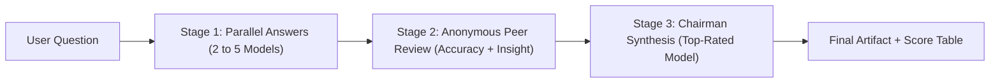
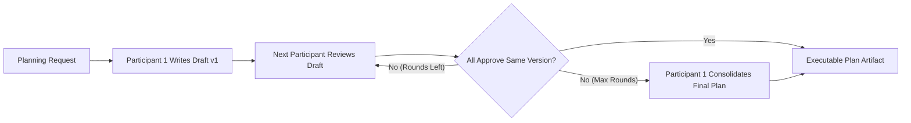

# agy-council

`agy-council` is a multi-model skill for [Google Antigravity](https://antigravity.google).
It lets two or more AI models answer tough questions together or agree on one technical plan.

The skill runs inside Antigravity. You do not need external servers, Docker containers, or API keys.

---

## Credit and Enhancements

### Inspiration
Andrej Karpathy's [`karpathy/llm-council`](https://github.com/karpathy/llm-council) inspired the three-stage Q&A workflow in **Mode 1**. In Karpathy's design, multiple models answer the same prompt, review anonymous peer answers, and let a chairman model write the final response.

### What `agy-council` Adds
`agy-council` adapts that concept into a native Antigravity skill and adds six capabilities:

1. **Blind Consensus Plan Mode (Mode 2)**: Two or three models take turns revising one shared Markdown plan. No model knows that other models exist.
2. **Strict Unanimous Exit**: Consensus Mode stops early only when every model approves the exact same plan version with zero edits. If the models reach the round limit without agreement, `Participant 1` writes a final consolidated plan.
3. **Self-Excluded Two-Axis Scoring**: Each reviewer grades **Accuracy (1–10)** and **Insight (1–10)** separately. No model grades its own answer, and each reviewer sees a new random order.
4. **Automatic Top-Rated Chairman**: In Council Mode, the skill automatically picks the model with the highest peer score to write the final answer.
5. **Isolated File Handoffs (Zero Board Leaks)**: Antigravity `swarm` workers share one message board by default. `agy-council` keeps all prompts, answers, scores, and drafts in local files so models never see peer work on the board.
6. **Codebase Access and Executable Plans**: Models can read files in your active workspace (read-only) to check facts. Consensus Mode outputs an Antigravity Plan Artifact with a **Proceed** button so you can run the agreed plan immediately.

---

## Functional Overview

*(Written in ASD-STE100 Simplified Technical English)*

### Mode 1: Council Q&A (`council`)

Use Council Mode when you want independent answers and peer verification for a technical question.



1. **Stage 1 — Independent Answers**: From 2 to 5 models read the same question at the same time. Each model writes its own answer to a separate file.
2. **Stage 2 — Anonymous Peer Review**: The helper script removes all model names and changes the order of the answers. Each model grades only the answers from the other models on **Accuracy (1–10)** and **Insight (1–10)**.
3. **Stage 3 — Chairman Synthesis**: The helper script calculates the average score for each model. By default, the model with the highest total score acts as Chairman and writes one complete final answer.
4. **Output**: Antigravity creates a Markdown Artifact with the final answer, the score table, and slides for every individual response and review.

### Mode 2: Blind Consensus Plan (`consensus`)

Use Consensus Mode when you want two or three models to challenge and improve an implementation plan until they agree.



1. **Random Slot Assignment**: The helper script assigns 2 or 3 models at random to `Participant 1`, `Participant 2`, and (optional) `Participant 3`.
2. **Blind One-on-One Framing**: Each model works inside its own conversation. Each model sees the latest draft as a revision in a one-on-one planning session and does not know about the other models.
3. **Turn-by-Turn Revision**: On each turn, the active participant reads the full plan. It either approves the plan with zero text changes (`agreed: true`) or writes a full updated plan (`agreed: false`), which resets prior approvals.
4. **Completion or Consolidation**: The loop stops as soon as all participants approve the exact same plan version (up to 3 rounds per model by default). If rounds run out first, `Participant 1` resolves the open points into one final plan.
5. **Output**: Antigravity writes a Plan Artifact with a **Proceed** button, turn-by-turn diffs, and a hidden spoiler section that reveals which model played each participant.

---

## Default Models and Portability

`agy-council` includes two built-in engines so it works across different Antigravity accounts and settings:

| Engine | When Used | Default Seats |
| :--- | :--- | :--- |
| **Cross-Vendor `swarm`** *(Primary)* | Whenever the `swarm` tool is active (Gemini coordinator selected) | **Gemini 4 Carbon** (`gemini-4-carbon-high`) + **Claude Opus 4.6** (`claude-opus-4-6-thinking`) |
| **Tier-Based `run_workflow`** *(Fallback)* | When `swarm` is unavailable in the current session | `inherit` (your selected chat model) + `pro` |

At the start of each `swarm` run, the skill checks live model availability and quota on your account. You can also add models such as `gpt-oss-120b-medium`, `gemini-4-hydrogen-xhigh`, or `claude-sonnet-4-6`. If a default model has `0%` quota on an account, the skill selects an available model automatically.

---

## Requirements

- [Google Antigravity](https://antigravity.google)
- Python 3.8 or newer on `PATH` (uses only the Python standard library)

---

## Installation

### Option A: Install Globally (All Projects)

1. Create your global skills folder if it does not exist:
   ```bash
   mkdir -p ~/.gemini/config/skills
   ```
2. Clone this repository as `council`:
   ```bash
   git clone https://github.com/kdvlr/agy-council.git ~/.gemini/config/skills/council
   ```
3. Start a new Antigravity conversation.

### Option B: Install in One Workspace Only

1. Run this command from the root of your project repository:
   ```bash
   git clone https://github.com/kdvlr/agy-council.git .agents/skills/council
   ```
2. Start a new Antigravity conversation in that project.

### Update to the Latest Version

```bash
git -C ~/.gemini/config/skills/council pull
```

---

## Usage Examples

Ask Antigravity in plain language:

- **Council Mode (Q&A)**:
  > *"Run a council on whether this service should use SQLite WAL or PostgreSQL."*
- **Consensus Mode (Planning)**:
  > *"Use council consensus mode to write a migration plan from JWT cookies to passkeys."*
- **Custom Seats**:
  > *"Run a 3-model council with Gemini 4 Carbon, Claude Opus 4.6, and GPT-OSS 120B to audit `src/auth/`."*

---

## Quota Note

Every model turn runs as an Antigravity agent turn and uses your Antigravity model quota:

- **Council Mode** with $N$ models uses $2N + 1$ agent turns ($N$ answers + $N$ reviews + $1$ Chairman synthesis).
- **Consensus Mode** with $K$ models and $R$ max rounds uses from $K$ turns (immediate agreement) up to $K \times R + 1$ turns.

---

## Repository Layout

```text
agy-council/
├── SKILL.md                     # Antigravity skill manifest and instructions
├── README.md                    # Documentation (Simplified Technical English)
├── LICENSE                      # MIT License
├── scripts/
│   ├── swarm_helper.py          # Primary cross-vendor swarm state and file isolator
│   └── council_workflow.py      # Fallback run_workflow engine
└── tests/
    └── test_swarm_helper.py     # Standard-library unit tests
```

Run the test suite locally:

```bash
python3 -m unittest discover -s tests -v
```

---

## License

Released under the [MIT License](./LICENSE).
